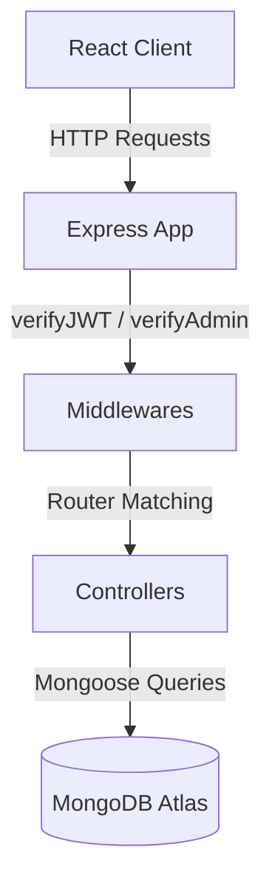

# Architecture Overview: Cafe Olive

This document details the architectural layout, components, routing, and access control models implemented in the Cafe Olive project.

---

## 1. Project Folder Structure

The project is structured as a monorepo consisting of two primary directories:

### A. Frontend Layout (`/frontend`)
- **`src/main.jsx`**: The application entry point.
- **`src/App.jsx`**: Router and route declarations (using `react-router-dom`).
- **`src/Layout.jsx`**: Global layout containing the public header ([`Navbar.jsx`](file:///e:/CAFEOLIVE/frontend/src/components/Navbar.jsx)) and footer ([`Footer.jsx`](file:///e:/CAFEOLIVE/frontend/src/components/Footer.jsx)).
- **`src/LandingPage.jsx`**: Main portal showcasing cafe sections, testimonials, and customer review submissions.
- **`src/MenuPage.jsx`**: Digital menu containing category filters, search, the cart system, and table/name-based order submission.
- **`src/GalleryPage.jsx`**: Interactive media gallery.
- **`src/ReservationsPage.jsx`**: Displays booking space cards (Mini Theatre, Party Hall 1, Party Hall 2) with links to reserve or inquire.
- **`src/layouts/AdminLayout.jsx`**: Sidebar layout for authenticated dashboard views, enforcing role permissions.
- **`src/pages/`**:
  - **`admin/`**: Sub-pages for dashboard, category management, inquiries tracking, reservation calendars, settings config, and review moderation.
  - **`chef/`**: [`ChefDashboard.jsx`](file:///e:/CAFEOLIVE/frontend/src/pages/chef/ChefDashboard.jsx) containing active kitchen orders.
  - **`waiter/`**: [`WaiterDashboard.jsx`](file:///e:/CAFEOLIVE/frontend/src/pages/waiter/WaiterDashboard.jsx) for waiter-initiated table ordering and service status updates.
  - **`customer/`**: [`BillPage.jsx`](file:///e:/CAFEOLIVE/frontend/src/pages/customer/BillPage.jsx) displaying active bill sessions and online payment options.
  - **`reservations/`**: Sanctuary booking systems, AM/PM slot selection, and confirmation interfaces.

### B. Backend Layout (`/backend`)
- **`src/index.js`**: Server initialization, connecting MongoDB and launching the Express app.
- **`src/app.js`**: Mounts parser, cookie-parser, and registers all `/api` router instances.
- **`src/routes/`**: Registers endpoints (e.g. `user.routes.js`, `order.routes.js`, `reservation.routes.js`, `inquiry.routes.js`, `review.routes.js`).
- **`src/controllers/`**: Core controller logic.
- **`src/models/`**: Mongoose schemas mapping database structures.
- **`src/middlewares/`**: JWT validation, admin route guarding, file parsing, and global error handling.

---

## 2. API & Database Communication

The frontend client communicates with the backend via HTTP REST endpoints. Axios defaults are set up to proxy requests to `http://localhost:3000` (in development).

---

## 3. Authentication & RBAC Flow

### Authentication
1. Admin and staff credentials are verified against standard BCrypt hashed passwords in MongoDB.
2. Upon successful login, the server generates an JWT `accessToken` (using `ACCESS_TOKEN_SECRET`) and returns it inside a cookie or HTTP header.
3. The client saves user context to `localStorage` (`adminUser`).

### Role-Based Access Control (RBAC)
Role types are defined by the enum: `['admin', 'manager', 'chef', 'waiter', 'customer']`.

- **Client Guarding**:
  - In [`AdminLayout.jsx`](file:///e:/CAFEOLIVE/frontend/src/layouts/AdminLayout.jsx):
    - `isAdmin` enables Statistics, Staff, Add Menu Items, System Settings, Reviews, and Inquiries links.
    - `isChef` enables the Kitchen KDS dashboard link.
    - `isWaiter` enables Service, Take Order, and Reservations links.
- **Server Guarding**:
  - [`auth.middleware.js`](file:///e:/CAFEOLIVE/backend/src/middlewares/auth.middleware.js) validates the signature of the incoming JWT.
  - [`admin.middleware.js`](file:///e:/CAFEOLIVE/backend/src/middlewares/admin.middleware.js) intercepts specific routes, verifying that `req.user.role === 'admin'` before proceeding.
