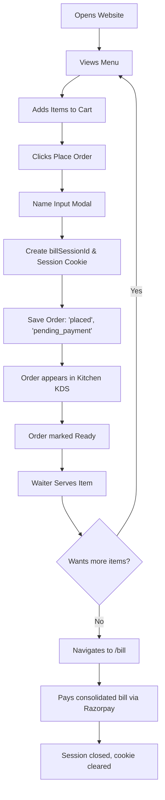

# Customer Journeys: Cafe Olive

This document maps the step-by-step flows and touchpoints for customers interacting with Cafe Olive's digital interfaces.

---

## 1. Normal Walk-in Customer Journey

For a walk-in guest who does not sit at a pre-designated QR table:

---

## 2. Table QR Customer Journey

For a customer sitting at a table scanning a QR code:

1. **Table Detection**:
   - The QR code contains a table number parameter (e.g. `http://localhost:5173/menu?table=3`).
   - The frontend parsed search params parse the table ID and save it in state (`tableNumber: "3"`).
2. **Order Placement**:
   - The customer browses the menu, adds items to the cart, and clicks **Place Order**.
   - Because a `tableNumber` is present, the customer name modal is skipped.
   - The order is sent directly with the table number, generating or adding to the existing `billSessionId` for that table/visit.

---

## 3. Sanctuary Reservation Flow

For booking venues like the Private Mini Theatre or Party Halls:

1. **Explore**: Customer clicks "Reserve Now" or navigates to `/reservations`.
2. **Select Venue**: Chooses between Mini Theatre, Party Hall 1, or Party Hall 2.
3. **Configure Options**:
   - Dates: Selects a date card (within 7 days) or enables **Choose Custom Date** to access a date picker.
   - Time: Chooses a starting slot, utilizing the **AM/PM toggle** to filter morning or evening hours.
   - Duration: Selects 1–4 hours or enables **Custom Duration** to input any value (e.g., 6 hours).
   - Guests: Specifies number of guests (validated against venue limits).
4. **Summary Review**: The sidebar displays:
   - Specific Date & Time
   - Computed End Time
   - Pricing breakdown (`Rate * Hours`)
5. **Checkout**: Click **Verify & Pay Reservation** → Razorpay payment modal opens → verify signature → displays Booking Confirmation page.

---

## 4. Reservation Inquiry Flow

For general inquiries before booking:

1. Customer navigates to `/reservations/inquiry`.
2. Fills in:
   - Full Name (Required)
   - Phone Number (Required)
   - Email (Optional)
   - Inquiry Type (Select Dropdown)
   - Preferred Event Date (Optional Date Picker)
   - Message details (Required)
3. Submits form → payload sent to `/api/inquiries` → saves to database.
4. Message is queued for Admin review on the dashboard.
