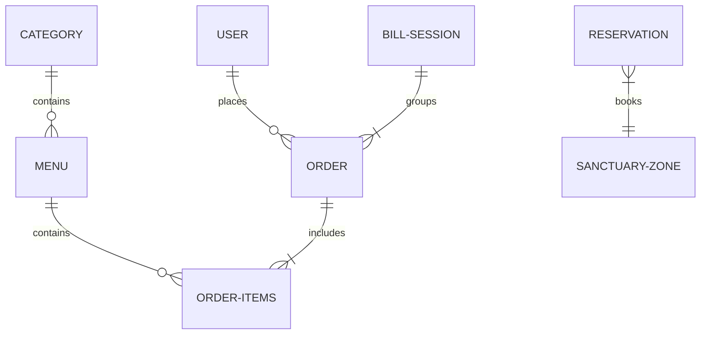

# Database Schema: Cafe Olive

This document details the MongoDB database schemas modeled using Mongoose in the Cafe Olive project.

---

## 1. Mongoose Models Overview

### A. User Model (`User`)
- **Path**: [`user.model.js`](file:///e:/CAFEOLIVE/backend/src/models/user.model.js)
- **Purpose**: Accounts for cafe personnel (Admin, Manager, Waiters, Chefs) and registered users.
- **Fields**:
  - `username` (String, required, unique, lowercase, index)
  - `email` (String, required, unique, lowercase)
  - `fullName` (String, required, lowercase, index)
  - `photo` (String, Cloudinary URL)
  - `role` (String, required, enum: `['admin', 'manager', 'chef', 'waiter', 'customer']`)
  - `password` (String, required, hashed via BCrypt in pre-save hook)
  - `refreshtoken` (String)

### B. Category Model (`Category`)
- **Path**: [`category.model.js`](file:///e:/CAFEOLIVE/backend/src/models/category.model.js)
- **Purpose**: Grouping structure for menu items (e.g. Desserts, Beverages).
- **Fields**:
  - `name` (String, required, unique trim)
  - `isActive` (Boolean, default: true)

### C. Menu Model (`Menu`)
- **Path**: [`menu.model.js`](file:///e:/CAFEOLIVE/backend/src/models/menu.model.js)
- **Purpose**: Details individual dishes or drinks sold by the cafe.
- **Fields**:
  - `name` (String, required)
  - `description` (String)
  - `price` (Number, required)
  - `image` (String, URL)
  - `category` (ObjectId referencing `Category`, required)
  - `isAvailable` (Boolean, default: true)

### D. Order Model (`Order`)
- **Path**: [`order.model.js`](file:///e:/CAFEOLIVE/backend/src/models/order.model.js)
- **Purpose**: Tracks ordering states, customer details, table numbers, and payment details.
- **Fields**:
  - `tableNumber` (String, optional, for table qr-scans/waiter selection)
  - `customerName` (String, optional, fallback for tableless orders)
  - `items`: Array of:
    - `menuItem` (ObjectId referencing `Menu`, required)
    - `name` (String, required)
    - `price` (Number, required, captured at time of ordering)
    - `quantity` (Number, required, default: 1)
    - `specialInstructions` (String)
  - `placedBy` (ObjectId referencing `User`, optional, used when waiter triggers order)
  - `totalAmount` (Number, required)
  - `status` (String, enum: `['pending_payment', 'placed', 'preparing', 'ready', 'served', 'completed', 'cancelled']`, default: `'placed'` for session flow)
  - `estimatedPreparationTime` (Number, minutes)
  - `isPaid` (Boolean, default: false)
  - `paymentStatus` (String, enum: `['pending', 'paid', 'failed', 'refunded']`, default: `'pending'`)
  - `paymentMethod` (String)
  - `paymentTimestamp` (Date)
  - `razorpayOrderId` (String)
  - `razorpayPaymentId` (String)
  - `razorpaySignature` (String)
  - `kitchenNote` (String)
  - `orderSource` (String, enum: `['customer', 'waiter']`, default: `'customer'`)
  - `waiterName` (String, name of placing waiter)
  - `billSessionId` (String, index, links multiple orders to one session)

### E. Reservation Model (`Reservation`)
- **Path**: [`reservation.model.js`](file:///e:/CAFEOLIVE/backend/src/models/reservation.model.js)
- **Purpose**: Booking schedules for private venues.
- **Fields**:
  - `type` (String, required, enum: `['theatre', 'partyHall1', 'partyHall2']`)
  - `name` (String, required)
  - `phone` (String, required)
  - `email` (String, required)
  - `date` (String, required, formatted `YYYY-MM-DD` in local time)
  - `startTime` (String, required, e.g. "02:00 PM")
  - `duration` (Number, hours, required)
  - `guests` (Number, required)
  - `occasion` (String)
  - `specialRequests` (String)
  - `totalAmount` (Number, required)
  - `paymentStatus` (String, enum: `['pending', 'paid', 'failed']`, default: `'pending'`)
  - `razorpayOrderId` (String)
  - `razorpayPaymentId` (String)
  - `status` (String, enum: `['pending', 'confirmed', 'cancelled']`, default: `'pending'`)

### F. Review Model (`Review`)
- **Path**: [`review.model.js`](file:///e:/CAFEOLIVE/backend/src/models/review.model.js)
- **Purpose**: Customer feedback displayed on the public landing page.
- **Fields**:
  - `name` (String, required)
  - `rating` (Number, required, 1 to 5)
  - `comment` (String)
  - `status` (String, enum: `['pending', 'approved', 'rejected']`, default: `'pending'`)
  - `createdAt` (Date, default: Date.now)

### G. Inquiry Model (`Inquiry`)
- **Path**: [`inquiry.model.js`](file:///e:/CAFEOLIVE/backend/src/models/inquiry.model.js)
- **Purpose**: Pre-booking inquiries for party halls or custom celebrations.
- **Fields**:
  - `name` (String, required)
  - `phone` (String, required)
  - `email` (String)
  - `inquiryType` (String, required, enum: matches form types)
  - `preferredDate` (String, `YYYY-MM-DD` representation)
  - `message` (String, required)
  - `status` (String, enum: `['new', 'in_progress', 'resolved']`, default: `'new'`)
  - `adminNotes` (String)

---

## 2. Relationships Model

- **Order Items & Menu**: Items ordered have `menuItem` matching a record in the `Menu` collection.
- **Order & User**: Waiter orders link `placedBy` to a waiter `User` record.
- **Menu & Category**: Each menu item references a single `Category`.
